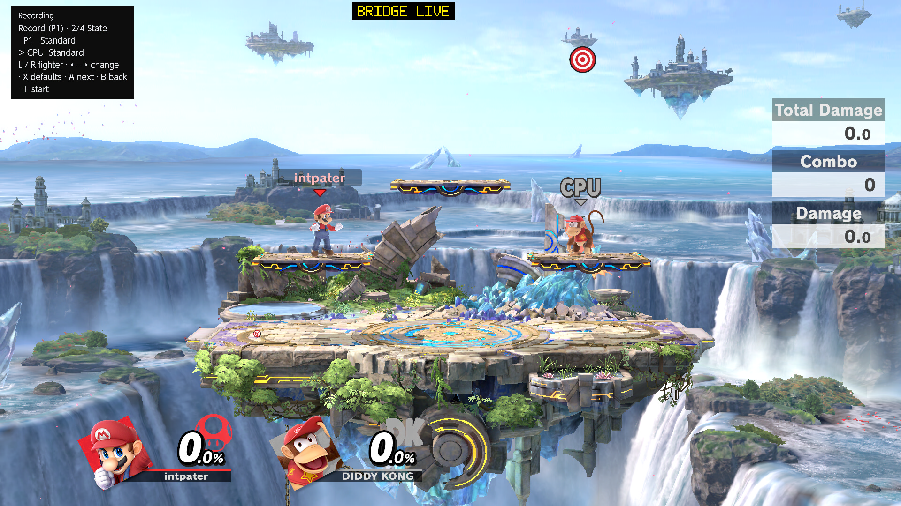

# Recording: place the fighters before Record

Choose where Player 1 and the CPU start a recording, what state each is in and how much damage each has; Play then
puts them back there every time.

Recorded in Eden on build `17060a5e`, 2026-11-23, Battlefield, in Training (untested on hardware; the waiting room is
not tested yet). Click the picture to play the clip (1080p, 60 fps, no sound). The yellow "BRIDGE LIVE" badge at the
top of the picture belongs to the test tools, not to the feature.

In the clip: the Recording pop-up, where **Y** turns "place first" On; Record opens the Spot page; Player 1's mark is
moved one step left, off the platform and onto the floor; the CPU is switched to off stage and moved up; its state is
set to Tumble and its damage to 30%; Preview; "Ready · 3 2 1" with both fighters held; two jabs are recorded;
Training's reset; then Play on Player 1 puts both fighters back and plays the jabs.

## For the README

**Place fighters before Record.** Open the Recording pop-up (**ZR + D-pad Right**) and press **Y**: the line at the
bottom reads "Y place first · On". Now Record (**ZR + D-pad Down**) first opens four pages, Spot, State, Percent and
Preview, for both fighters. **L** and **R** switch between Player 1 and the CPU. Press **+** on any page to start:
both fighters are put on their spots, held through "Ready · 3 2 1", and released together as the recording begins.
The start is saved with the macro, so Play puts both fighters back on it.

| Button | What it does |
| --- | --- |
| ZR + D-pad Right, then Y | Turns "place first" On or Off (also the row Recording › Options › Place fighters before Record) |
| ZR + D-pad Down | Record. With "place first" On it opens the four pages |
| L / R | Switches between Player 1 and the CPU |
| Y | Spot page: on stage or off stage for that fighter |
| Stick, D-pad | Spot page: moves the spot. State page: Left and Right change the state. Percent page: Left and Right change it by 1, Up and Down by 10 |
| X | Back to the fighters as they stand now. On Missed tech: face up or face down |
| A / B | Next page / back one page. B on the first page closes |
| + | Starts from any page |
| ZR + D-pad Left / Up | Play on Player 1 / on the CPU |

It is Off by default.

## The setting

Off: Record starts at once, as before. On: Record first opens the four pages. The text at the top left names who
will be recorded and the page, for example "Record (P1) · 1/4 Spot", and lists both fighters; the `>` marks the one
you are editing.

The next Record on the same stage opens on the setup you started last. **X** puts back the fighters as they stand
now.

## Spot: on stage or off stage

Each fighter is placed on its own: Player 1 can be on the stage while the CPU is off it.

- **On stage.** The mark sits on the floor under it. Move it left and right. Down drops it to the floor below a
  platform and Up puts it back on the platform, so a fighter can start under one.
- **Off stage.** **Y** switches the fighter to a crosshair that moves freely in the air.

The stick moves fast and the D-pad moves one step a press. The fighters keep the way they were facing.

## State: how each fighter starts

Left and Right change the state of the fighter you are editing. Both fighters begin their states on the same frame
as the recording's first input.

| Where | State | What the fighter does at the start |
| --- | --- | --- |
| On stage | Standard | Stands |
| On stage | Missed tech | Hits the ground and lies there. **X** chooses face up or face down |
| On stage | Trip | Slips and sits on the ground |
| Off stage | Standard | Falls normally |
| Off stage | Tumble | Falls as after being launched |
| Off stage | Helpless | Falls as after an up special and cannot act until it lands |
| Off stage | Footstool | Is pushed down as if just jumped on |

A fighter that is neither recorded nor played acts on its own from that first frame: a CPU left to itself gets up
from a missed tech as soon as it can.

## Percent

Each fighter's damage at the start: Left and Right change it by 1, Up and Down by 10.

## Preview and Ready

Preview lists both fighters with their spot, state and percent. **A** or **+** starts. Both fighters are put on
their spots and held through "Ready · 3 2 1", then released together as the recording begins. **B** during the count
cancels and nothing is recorded.

## Playing it back

Play on Player 1 (**ZR + D-pad Left**) or on the CPU (**ZR + D-pad Up**) puts both fighters back on their spots, in
their states and at their percent, and plays at once, with no count.

## Messages

| Message | When |
| --- | --- |
| Stop the practice game to place fighters | A practice game is running; stop it first |
| Not recorded · {fighter} could not start in {state} | A fighter could not begin its state, so the recording was dropped |
| Not placed · {fighter} could not start in {state} | The same on Play: playback stops and the saved start is kept |

## Not tested yet

- The waiting room. The feature is built to work there the same way, but no test has run in a room.
- A Switch console.
