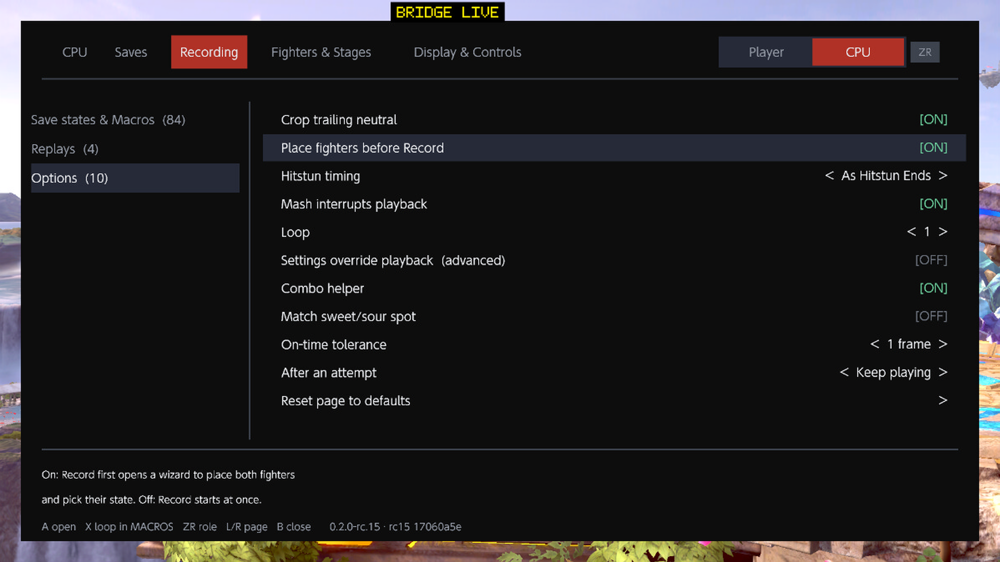
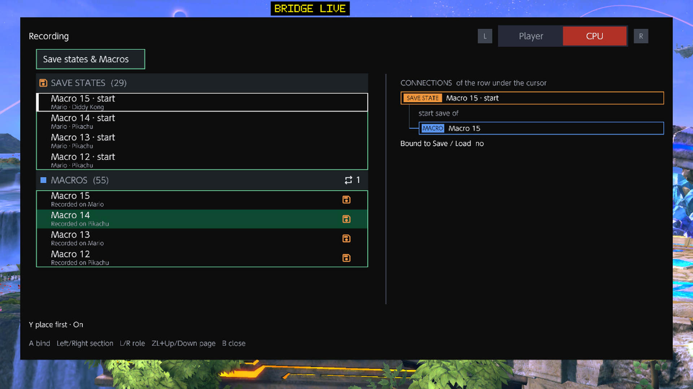
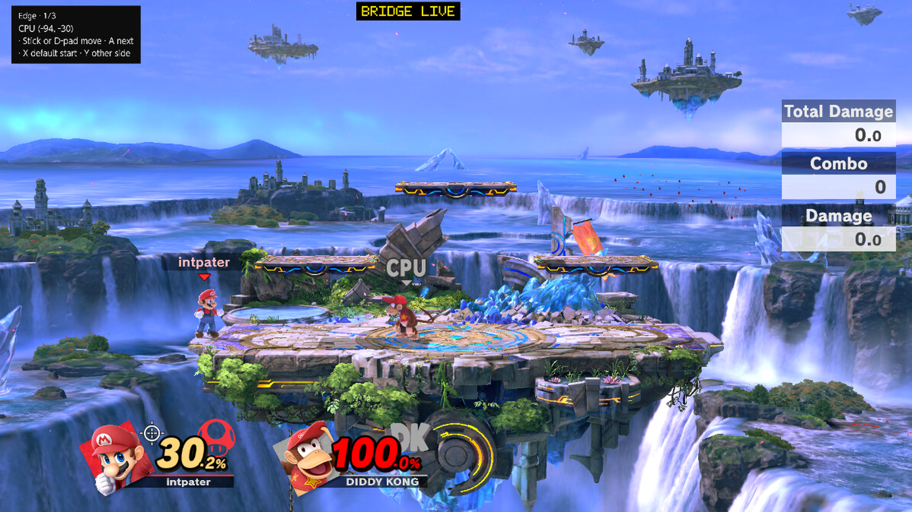
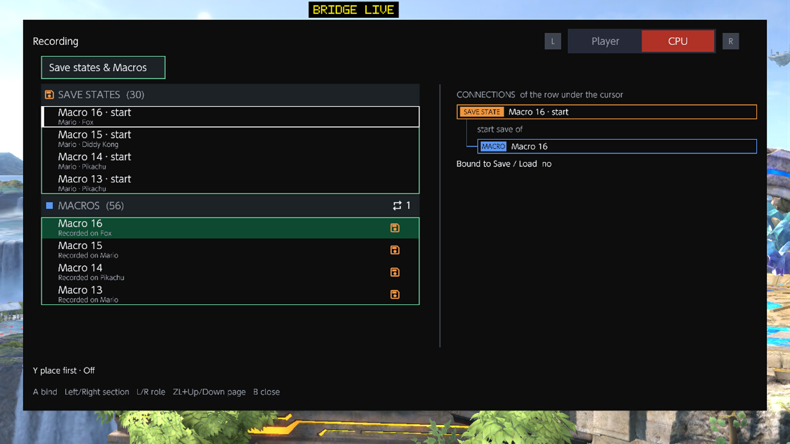

# Recording: see and keep your role, a clear view in wizards, CPU takes on the right fighter

Four small Recording changes in this build. Each has one sentence, its buttons and a short clip.

Recorded in Eden on build `17060a5e`, 2026-11-23, Battlefield, in Training (untested on hardware). Click a picture to
play its clip (60 fps, no sound; the game's picture was 1198 x 674 and is scaled up to 1080p).

## 1. The Recording page shows your role

The Recording page now shows **Player** and **CPU** at the top right, with the one you are on lit, the same as the
pop-up.

| Button | What it does |
| --- | --- |
| B + D-pad Up | Opens the menu; **L / R** go to the Recording page |
| ZR | Switches between Player and CPU |

In the clip: the page is on CPU, **ZR** goes to Player and **ZR** again back to CPU, then the menu is closed.

## 2. The pop-up remembers your role

The Recording pop-up opens on the role you picked last time instead of always starting on Player; the choice is kept
on the card, so it is still there after a restart.

| Button | What it does |
| --- | --- |
| ZR + D-pad Right | Opens the Recording pop-up |
| L / R | Picks Player / CPU |
| B | Closes the pop-up |

In the clip: the pop-up opens on Player, **R** picks CPU, **B** closes it, and it opens again on CPU.

## 3. The input strip steps aside during a wizard

While a set-up wizard is open, the input strip at the top of the screen hides so it does not cover the stage, and it
comes back when the wizard ends.

Nothing to press.

In the clip: Guard the Edge > **Set up…** opens the wizard and the strip is gone, **B** leaves the wizard, and with
the menu closed the strip is back.

## 4. A CPU recording starts on the fighter you see

After you change the CPU's fighter, a CPU recording starts from that fighter, also when Save States is turned off.

| Button | What it does |
| --- | --- |
| R in the pop-up | Picks CPU as the role to record |
| ZR + D-pad Down | Starts Record; press it again to stop |

In the clip: Save States is Off and the CPU has just been changed from Pikachu to Fox. Record starts, Fox jabs once,
Record stops, and the pop-up lists the new "Macro 16" as "Recorded on Fox" with its start save "Mario · Fox".

## Not in these clips

- A waiting room with Lobby Practice on, and a console.
- A restart: clip 2 shows the pop-up closed and reopened in one session.
- The CPU change itself and the Save States switch in clip 4: both were done just before the clip starts.
- The other wizards that hide the strip the same way: Juggler, the Eggs-ercise Off-stage zone editor, Tech practice,
  Break the Targets and Record placement.
- The "BRIDGE LIVE" label at the top of the picture belongs to the test set-up, not to the mod.
