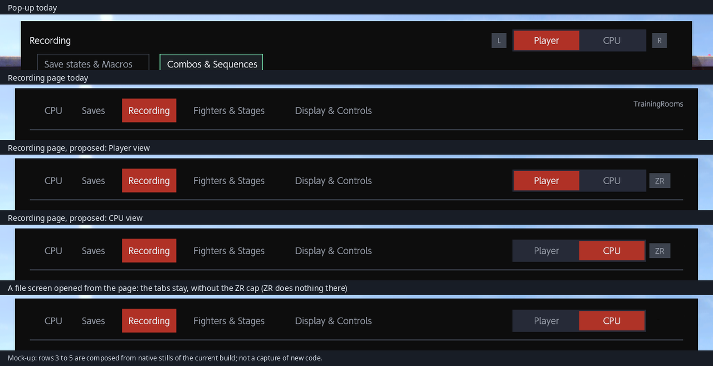

# Recording: which role you are on (page and pop-up)

**Decided, 2026-11-22.** RR1 and RR2 agreed as written; RR3 changed to "keep it on the card". The picture is corrected for
one point the review found: the ZR key cap was shown on a file's own screen, where ZR does nothing.
Mock-up, not an Eden still (preview-vis-sol, source `aad616bc`, branch `rc15/recording-menu-mix`). Built in commits
`cfa25884` (RR1, RR2) and `45553a3a` (RR3); the Eden proof is still to come.

Your words: "in recording on the menu when you change roles it's not clear what role you're on. we should make it clear like we do in the pop up." and "when you bring up the recording dialogue menu with ZR+D-Right it should remember which role you had picked before vs always restarting on p1."

## RR1: the Recording page shows the pop-up's role tabs (agreed)

- The page gets the same plate as the pop-up, in the same place on the top line: "Player" and "CPU", the current one lit red.
- One key cap, **ZR**, to the right of the plate. ZR already changes the role on the page; L and R change the menu page there, so they cannot be the role buttons as in the pop-up.
- **Corrected:** the ZR cap is drawn only where ZR changes the role. On a file's own screen, a picker or the keyboard opened from the page, the tabs stay and the cap is not drawn (row 5).
- The small "TrainingRooms" label at the top right is not drawn on the Recording page, as in the pop-up. It stays on the other pages.
- Nothing else on the page changes.

Rows 1 and 2 are the build you have. Rows 3 to 5 are composed from native stills; the "ZR" cap is drawn in.

## RR2: the page and the pop-up each keep their own role (agreed: two roles)

- **Pop-up role:** who Record captures and whose macros and loops the pop-up lists.
- **Page role (ZR):** whose files the page lists.
- They stay separate, as today. Both are remembered, each on its own.

## RR3: how long the role is remembered (changed: kept on the card)

- Both roles are saved in `settings.json` on the card as soon as you change them, so they survive closing the menu, a
  Training reset, leaving Training, and closing and starting the game again.
- A `settings.json` from an older build has no saved role: both start on Player, and nothing else in the file changes.
