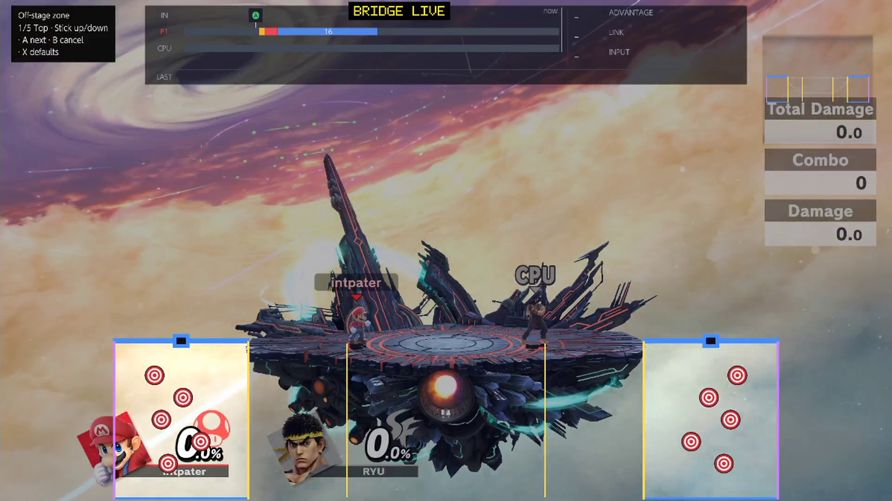

# Eggs-ercise: the Off-stage zone editor shows the zones as windows

The Off-stage zone editor lets you choose, for each stage, the areas beside the stage where Eggs-ercise targets may
appear; it now shows them as clear windows in a dimmed picture, with the edge you are moving marked.

Recorded in Eden on build `7365aa4a`, 2026-11-23, Final Destination, in Training (untested on hardware). Click the
picture to play the clip (60 fps, no sound; the game's picture was 1198 x 674 and is scaled up to 1080p).

## For the README

**Eggs-ercise: Off-stage zone…** Open the menu, go to Fighters & Stages > Practice games > Eggs-ercise, and choose
**Off-stage zone…**. The menu closes and you see the whole stage. Everything is dimmed except the zone on each side of
the stage: targets appear inside those windows. Five steps set the zone: Top, Bottom, Inner edges, Outer edges and
Preview. Move the marked edge with the stick and press **A** for the next step. On Preview, **A** or **+** saves the
zone for this stage. It is used from the next Eggs-ercise Start.

| Button | What it does |
| --- | --- |
| Stick up / down | Top and Bottom steps: moves that edge |
| Stick left / right | Inner and Outer steps: moves those edges, on both sides at once |
| A | Next step; on Preview, save |
| B | Back one step; on the first step, cancel and go back to the menu |
| X | Back to the stage's default zone (jumps to Preview) |
| + | On Preview, save |

## What you see

- **The windows.** The clear areas are the zones. Everything else is dimmed, on bright and dark stages alike.
- **The edges.** Blue is the top and the bottom, yellow the inner edge (towards the stage), purple the outer edge
  (towards the side of the screen). The edge of the current step is thicker and carries a small handle. On Preview all
  four are thick.
- **The thin yellow line** on each side shows how far under the stage the inner edge can go.
- **The small targets** inside a window are sample spots where a target can appear.
- **The small picture at the top right** appears when part of a zone is outside the screen. It shows the whole zones
  against the outline of the stage.
- **The text at the top left** names the step and its buttons. On Preview it also shows the zone's numbers.

## The five steps

1. **Top.** Stick up and down moves the top of both zones. A zone cannot be made shorter than one target.
2. **Bottom.** The same for the bottom.
3. **Inner edges.** Stick left and right moves the edges nearest the stage, on both sides together, between the ledge
   and the thin yellow line.
4. **Outer edges.** The same for the edges farthest from the stage.
5. **Preview.** Check the zones and their numbers. **A** or **+** saves and you read "Applied"; **B** goes back a
   step; **X** puts the default zone back.

**B** on the Top step leaves without saving and opens the menu again. A stage with room on one side only, such as the
Training stage, has one window.

In the clip: the menu, Off-stage zone…, the top raised and lowered, the bottom lowered, the inner and outer edges
moved, Preview, and **A** saving the zone.

## Not in this clip

- A waiting room with Lobby Practice on. The editor is the same there; its Eden test is in the combined build.
- A console.
- The "BRIDGE LIVE" label at the top of the picture belongs to the test set-up, not to the mod. The input display
  under it is the mod's own; when it is on, it is drawn over the top of the picture, also over a zone's edge there.

Checked in Eden on this build, on Final Destination and on the Training stage, every check passing: open and cancel,
the five steps, every edge moved both ways, save, reopen, default, and the ends of every edge.
