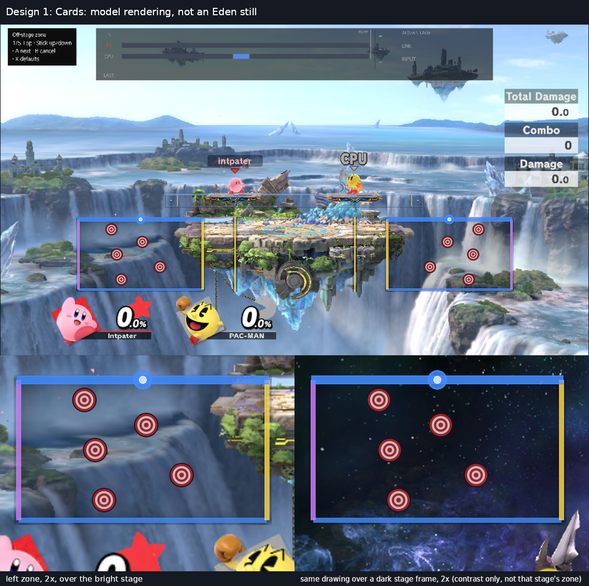
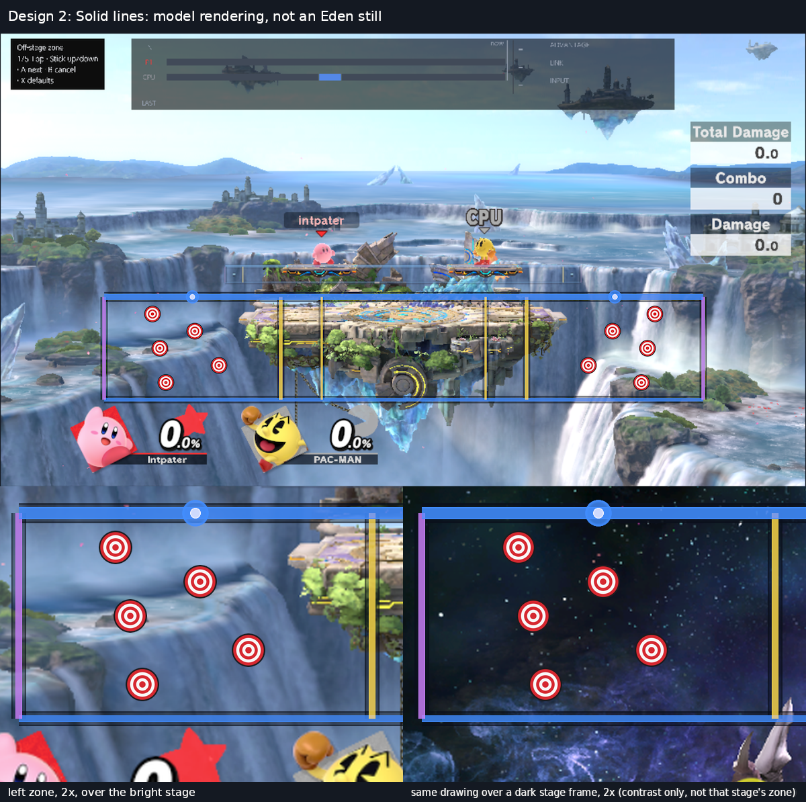
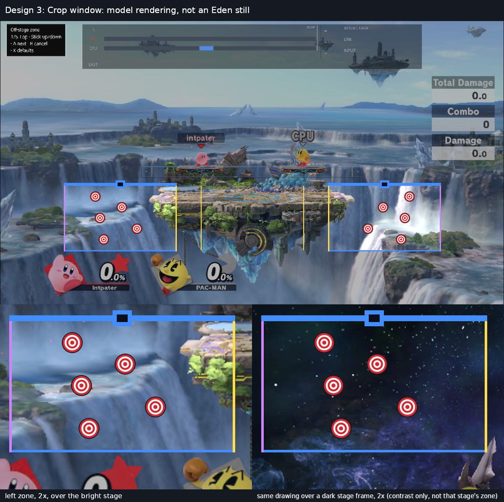

# Eggs-ercise zone editor: three redesigns (for the operator's pick)

Model renderings, not Eden stills (2026-11-22, fusion-g2-3, commit `a92bc320`, the top boundary shown active as the step-1 notice says on `rc15-zone-guide-contrast-rebased`).
Each picture shows the design over the bright Small Battlefield still of run B7; below, the left zone at 2x over that still and over a dark frame.

All three keep the hitbox pill cap at 170 and add no pane, texture or material. The hitbox drawing is already off while the editor is open, so the editor borrows its idle bands and caps (and the practice games' ten target pictures) and gives them back when it closes.

Kept in all three: the five steps and their buttons, both zones, the four boundaries in today's colours, the active boundary (thicker, with a handle), the inner limit, the inset.
Changed in all three: up to five sample target pictures a side show where a target can appear, in place of the hatching.

## Design 1: Cards (recommended by the lane)

Each zone is a dark glass card with coloured edges. About +50 to +80 lines. Unproven on a running game: how stacked bands look, a large band's rim.

## Design 2: Solid lines

Today's lines, eight in place of 28 strokes, each solid with a dark line under it. About +30 to +50 lines. Unproven: how stacked bands look.

## Design 3: Crop window

Everything outside the zones dimmed, the zones clear, thin crisp edges. About +150 to +200 lines. Unproven: drawing the menu's rectangles while the menu is closed, and whether the game's HUD sits over or under them.

