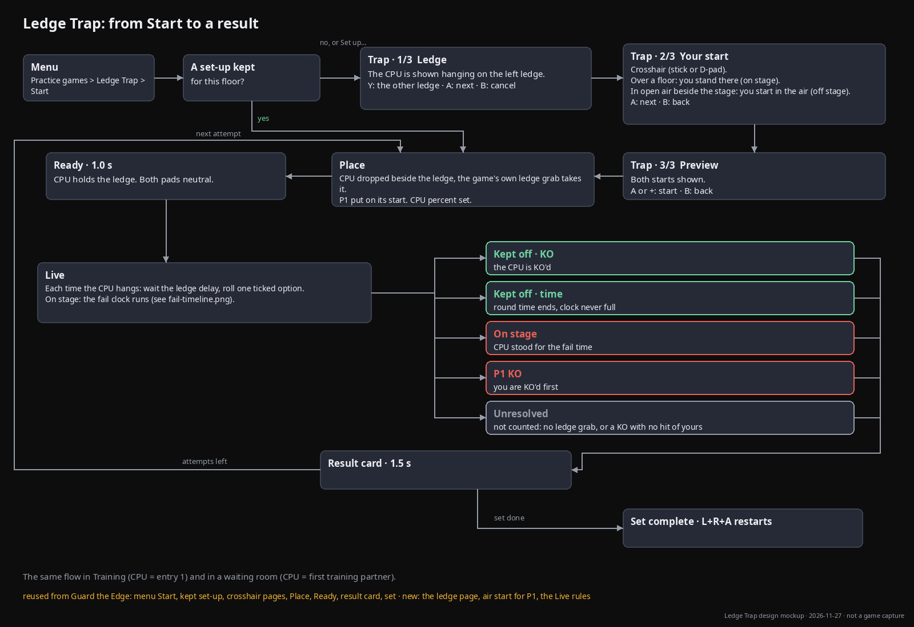
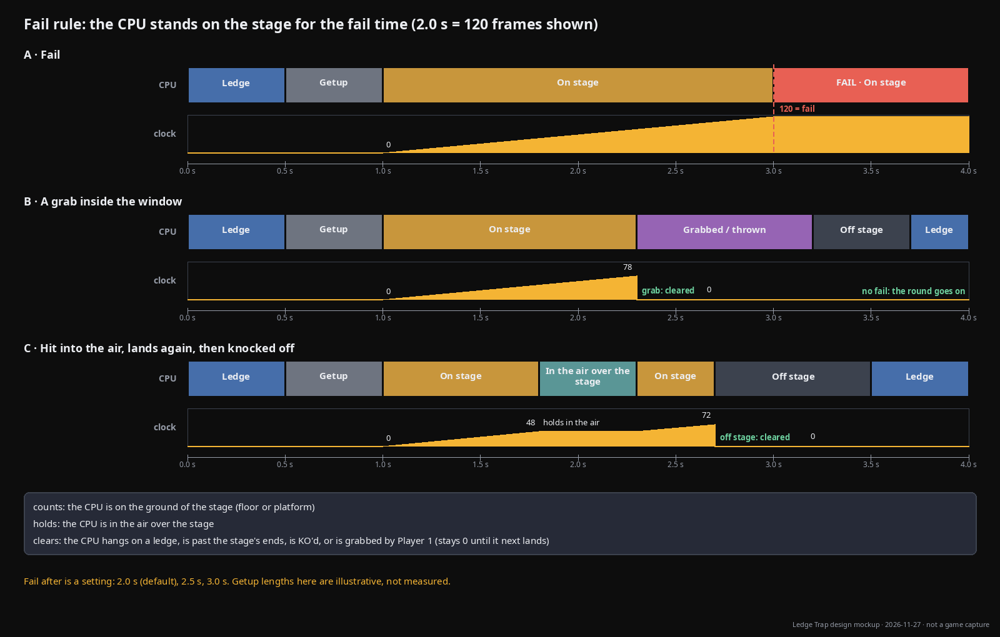
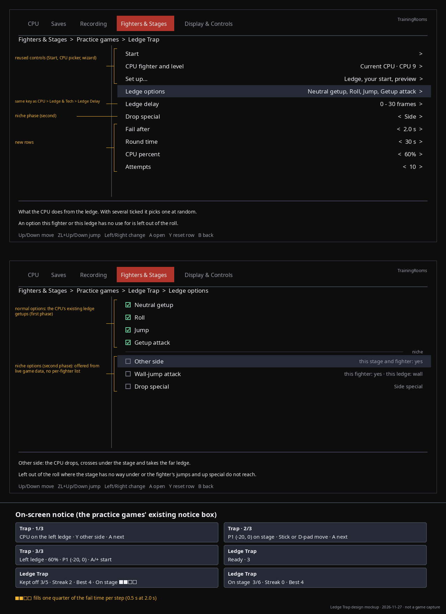

# Ledge Trap: a practice game (DESIGN, no code yet)

2026-11-27, lane `ledge-trap`, for tr-primary-2's ruling. Source read: TrainingRoomsForUltimate `main` `30f7f21a`
(paths below are in that tree: a path without a prefix is under `src/model/`, `runtime/…` is under `src/`;
`perfect…` and `picker.rs` are in `src/model/edge_juggle/`, `niche_pad.rs` in `src/runtime/features/edge_juggle/`).
Playbook `c8d9959`. Nothing is built or changed. Facts carry a file and line; anything not verified is marked
**assumption**. The three pictures are drawings made by `make_illustrations.py` beside this file, not captures.

**In one line:** Ledge Trap is a third drill of the Guard the Edge / Juggler engine. The CPU hangs on a ledge,
takes ledge options from a ticked list, and the round fails when it has stood on the stage for the fail time.

## 1. Flow

| Step | What happens | Reused from |
| --- | --- | --- |
| Menu | Fighters & Stages › Practice games › Ledge Trap › Start (Stop while it runs) | `practice_games.rs:9-55`, `menu/table.rs:99-109, 136-156, 527-530`, `runtime/features/practice.rs:41-98` |
| Pick the CPU | "CPU fighter and level" row: current CPU or a fighter, CPU 1–9 | picker `edge_juggle/picker.rs:157-238`, row `menu/table.rs:634-636` |
| Wizard 1/3, Ledge | The CPU is shown on the left ledge of the floor Player 1 stands on; Y takes the other ledge | `Wizard::set_side_default` `edge_juggle.rs:1220-1232`; stage and ledges `start_stage` `edge_juggle.rs:801-821` |
| Wizard 2/3, Your start | Crosshair. Over a floor: Player 1 stands there (on stage). In open air beside the stage: Player 1 starts in the air (off stage) | crosshair `edge_juggle.rs:1234-1251`; place classes `stage_geometry.rs:121-136, 179`; floor snap `runtime/features/placement.rs:12-18` |
| Wizard 3/3, Preview | Both starts shown; A or Plus starts | `edge_juggle.rs:1299-1319`, `Kind::DrillStart` `wizard.rs:6` |
| Kept set-up | Start reuses the set-up on the floor it was made on | `Kept`, `kept_setup` `edge_juggle.rs:994-999, 1207-1218` |
| Place | The CPU is put in Fall just outside the ledge and the game's own ledge grab takes it; Player 1 is put on its start; CPU percent is set | `try_place` `runtime/features/edge_juggle.rs:1646-1698`, `runtime/features/placement.rs:28-45` |
| Ready, 1.0 s | The CPU holds the ledge, both pads neutral | `Phase::Ready`, `held_pad` `edge_juggle.rs:383-422`; climb denied `cpu/ledge.rs:97-118` |
| Live | Each time the CPU hangs: wait the ledge delay, roll one ticked option, perform it | `Ledge::frame` `cpu/ledge.rs:122-205` |
| Result | Card for 1.5 s, then the next attempt or "Set complete · L+R+A restarts" | `finish_attempt`, `Phase::Result/Done` `edge_juggle.rs:592-605, 674-683` |

## 2. Rules

**The stage clock** (frames, 60 per second), one per round:

| The CPU | Clock | Read from |
| --- | --- | --- |
| stands on a floor or platform (situation Ground) | counts up | `runtime/features/edge_juggle.rs:2161, 2166` |
| is in the air over the stage (x between the floor's ends) | holds | `Stage::on_run` `edge_juggle.rs:845-847` |
| hangs on a ledge, is past the floor's ends, or is KO'd | clears to 0 | `SituationCliff` `cpu/ids.rs:102`; KO `runtime/features/edge_juggle.rs:2153` |
| is grabbed by Player 1 | clears to 0 and stays 0 until it next lands | grab read, §5 |

| Outcome | When | Counts as |
| --- | --- | --- |
| **On stage** | the clock reaches the fail time | fail |
| **P1 KO** | Player 1 is KO'd before the CPU | fail |
| **Kept off · KO** | the CPU is KO'd (a missed ledge ends here too) | success |
| **Kept off · time** | the round time ends and the clock never filled | success |
| Unresolved | the CPU never took the ledge at Place, or it was KO'd in a round where Player 1 never hit or grabbed it | not counted |

- **Fail time: a setting, 2.0 s by default** (2.0, 2.5, 3.0 s). Reason for 2.0: the clock starts on the first
  grounded frame, so part of it is the getup itself; 2.0 s leaves about one read and one punish, and 3.0 s lets a
  missed punish be tried again, which is no longer a trap. Getup lengths are an **assumption** (not measured here).
- **A grab inside the window is not a failure:** it clears the clock. A throw that leaves the CPU on the stage
  starts a new window at its landing.
- **Round time: 30 s by default** (20, 30, 60 s, Until KO). No return window after the KO: Guard the Edge's GJ1
  rule (`docs/DECISIONS.md` 1607) is about an edge-guard off stage and is not copied here.
- **Score:** kept off / attempts, streak and best streak, fastest KO, as Guard the Edge shows them
  (`runtime/features/edge_juggle.rs:1781-1791`; pools `practice_games.rs:82-112`).

## 3. Menu

| Row | Values (default bold) | Key | Status |
| --- | --- | --- | --- |
| Start / Stop | | | reused control (`menu/table.rs:632`) |
| CPU fighter and level | **Current CPU**, a fighter; **CPU 9**, 1–8 | `trap_cpu_fighter`, `trap_cpu_level` | reused picker; Perfect and Zoom not offered |
| Set up… | the wizard | | reused editor (`menu/table.rs:639`) |
| Ledge options | ticks: **Neutral getup, Roll, Jump, Getup attack**; Other side, Wall-jump attack, Drop special | `trap_options` | new row; the first four are `cpu/ledge.rs:16-21` |
| Ledge delay | as CPU › Ledge & Tech | `ledge_delay` | same key, second row (precedent `menu/table.rs:565-566`) |
| Drop special | **Side**, Neutral, Down | `trap_special` | new, niche phase |
| Fail after | **2.0 s**, 2.5 s, 3.0 s | `trap_fail` | new |
| Round time | 20 s, **30 s**, 60 s, Until KO | `trap_time` | new |
| CPU percent | 0–300%, **60%** | `trap_cpu_percent` | new |
| Attempts | **10**, 20, Free | `trap_attempts` | new |

- **Random** is the menu's existing idiom: several ticks, one rolled per hang (`menu/table.rs:312-313`). The
  default ticks the four normal options. The list shows the normal options first and the niche ones under a divider.
- **An option that does not apply** on this stage or for this fighter is left out of the roll. If nothing ticked
  applies, the four normal options are rolled. No new refusal text: starts reuse the drills' approved ones
  (`docs/RESTRICTIONS.md`: `edge-juggle-no-open-ledge`, `-stage-unread`, `-start-no-floor`, `-cpu-playback-busy`).
- **Game order and codes:** Ledge Trap is appended as the eighth game, so stored codes stay
  (`practice_games.rs:126-136`). This follows `docs/DECISIONS.md` "rc.15 practice menu" (2026-11-18, line 689).

## 4. Niche options: chosen from live game data

No new per-fighter table. Each option is offered when its checks pass on the frame the CPU hangs.

| Option | The CPU does | Offered when | Data read |
| --- | --- | --- | --- |
| Wall-jump attack | drops, drifts to the wall under the ledge, wall-jumps, attacks toward the stage; then the stock CPU recovers | the fighter can wall-jump **and** this ledge has a wall under it at least as tall as the fighter | fighter param `wall_jump_type` is true (H1, measured below), read beside `jump_count_max` (`runtime/features/edge_juggle.rs:894`); wall from the stage outline (`stage_geometry.rs:56`, `runtime/features/stage_geometry.rs:205-211`) |
| Drop special (the crown) | drops, midair-jumps, uses the chosen special toward the stage, returns to the ledge | a midair jump is left **and** the up special alone returns from the release point **and** the special's transition is open | `remaining_jumps` `runtime/features/edge_juggle.rs:888`; `Reach::returns` `perfect/recovery.rs:273`; terms `niche_pad.rs:1366-1372` |
| Other side | drops, crosses under the stage, takes the far ledge | the stage has a way under **and** this fighter's crossing has spare climb from its live jumps and up special | `crossing_band` `perfect.rs:541-552`; `Row::margin` `perfect/niche.rs:129-140`; `crossing_margin` `perfect/recovery.rs:525-576` |

- **How they are flown:** as pad edits over the stock CPU's pad, the existing seam (`Correction`
  `perfect.rs:639-644`, `ai_correction` `runtime/features/edge_juggle.rs:549-592`). No new hook.
- **Wall-jump:** the script presses away from the wall near it and stops when the wall-jump status does not come
  within a bound (**assumption H2**: `FIGHTER_STATUS_KIND_WALL_JUMP` resolves through the constant table,
  `cpu/ids.rs`). The game decides whether a wall-jump happens.
- **Drop special** names no fighter. With K. Rool as the CPU and Side ticked it is the crown; the player picks
  the fighter and the special.
- **Other side inherits two existing lists,** added for Guard the Edge's Perfect mode, with no new rows:
  - stages: Battlefield, Final Destination, Waiting Room (`perfect.rs:535-538`), the stages whose underside was
    checked for a crossing (test at `perfect.rs:1344`);
  - fighters: those with a measured crossing row (`perfect/niche.rs:240-287`).
  A list-free version would trust `crossing_margin` alone on any stage; a wrong estimate there is a self-destruct.
- **H1 is measured** (2026-11-27, stock 13.0.5 `fighter/common/param/fighter_param.prc` from the local
  `data.arc`): `wall_jump_type` is a true/false field of each of the 94 `fighter_param_table` rows, true for 34.
  Mario, Pikachu, Fox, Sheik and Lucario are true; K. Rool, Donkey Kong, Kirby and Ganondorf are false. The
  plugin's param readers today are for whole numbers and floats, so how it reads a true/false param is checked
  with the first slice.
- **H2 is still an assumption,** checked before code on an Eden boot that is already running.

## 5. What is reused, what is new

| Need | Exists at | Ledge Trap adds |
| --- | --- | --- |
| CPU ledge getups: neutral, roll, jump, attack, delay, re-roll per hang | `cpu/ledge.rs:16-23, 122-205`; row `menu/table.rs:312-315`; climb hook `runtime/features/cpu.rs:1029-1052` | the drill's CPU runs this step alone, with `trap_options` as its weights (today a drill switches all CPU settings off for its CPU: `runtime/features/cpu.rs:405, 655`) |
| Start-placement wizard, kept set-up, placement | `edge_juggle.rs:983-1329`; `runtime/features/edge_juggle.rs:1579-1698` | a ledge page (two choices) in place of the free CPU point; an air start for Player 1 |
| CPU recovery after a hit | stock CPU at the picked level (`Mode::Cpu`, `runtime/features/edge_juggle.rs:588-590`) | nothing |
| Niche groups | per-fighter recovery rows `perfect/niche.rs:93-125, 240-312`, flown by `niche_pad.rs:39, 124, 792`; Hero's Zoom group `picker.rs:122-131` | two generic scripts (wall-jump, drop special); Other side uses the crossing rows |
| Attempt clock, outcomes, set, bests | `Session` `edge_juggle.rs:512-775`; `Outcome`, cards `290-323, 392-413` | a third `Drill`, four outcomes, the stage clock |
| HUD notice and bridge state | `post_notice` `runtime/features/edge_juggle.rs:1722-1802`; `practice_fields` `edge_juggle.rs:713-757`; `practice_state.rs:38-141` | texts; one field `stage.frames`; game name `ledge_trap` |
| Grab detection | the CPU's status is a capture status and the capture link's parent is Player 1: `runtime/features/edge_juggle/zoom.rs:145-152` (statuses `cpu/ids.rs:321-332`); Mash out's capture read `mashout/run.rs:137-147` | the same read, moved to a shared helper |
| Menu group, Start/Stop, one game at a time | `menu/table.rs:99-109, 136-156, 515-663`; `runtime/features/practice.rs:41-98`; `practice_games.rs:73-79` | one group, ten rows |
| Other games' grading and counters, for comparison | Tech `tech/session.rs:18, 92, 261-275, 322-428, 511-516`; Juggler `edge_juggle.rs:656-668, 768-771`; Eggs-ercise `eggs.rs:347, 722`, streak `hit_streak.rs:125-239`; Parry `parry.rs:31-39, 62, 90`, `parry_practice.rs:10-55`; Break the Targets `btt.rs:55-61, 742-764` (phases, clock, best time), rows `menu/table.rs:554-567` | nothing |

## 6. Training and the waiting room

The standing rule is `docs/DECISIONS.md` 1891 (2026-11-22): every feature works the same in both.

| Piece | Training | Waiting room | Source |
| --- | --- | --- | --- |
| The CPU | entry 1 | the first training partner (entry 4) | `runtime/features/edge_juggle.rs:308-310`; `lobby/practice_policy.rs:13-18` |
| CPU type and level | pause panel | set and given back by the partner lease | `PartnerLease` `edge_juggle.rs:202-240` |
| Restart | L+R+A reset hub | the room's L+R+A | `runtime/features/reset_hub.rs:71`; `runtime/features/states/quick_reset.rs:68` |
| Lobby Practice turned Off | | the drill stops first, then the partner is given back | `runtime/features/edge_juggle.rs:330-336` |
| CPU ledge step | scene-aware roles | the same | `runtime/features/cpu.rs:401-407` |

Ledge Trap is a `Drill`, so it takes these paths unchanged. One parity test runs the same table of cases through
both contexts, and the Eden rows cover both scenes.

## 7. Size

**Measured today** (INBOX 2026-11-27 07:13:47Z and 10:18:17Z): release NRO 5,423,104 B, at its allowance; room
before a further 4,096 B page: text 2,352 B, read-only data 2,760 B, data 1,968 B; counted lines 209,561 of
209,561. Two fixes (`tech-manual-reach`, `overlay-handoff`) already ask for the text room.
**Rate used:** the last fold added 468 counted lines and 4,816 B of text (10.3 B per line); the whole image has
13.3 B per line. One sample, so every byte figure below is ±50% until a first slice is measured.

| Part | Counted lines | Text | Read-only data | Data | NRO file |
| --- | ---: | ---: | ---: | ---: | ---: |
| Phase 1: the game with the four normal options | about 525 | 5.4–7.0 KB | about 2.2 KB | about 1.1 KB | +4,096 to +12,288 B |
| Phase 2: the three niche options | about 320 | 3.3–4.3 KB | about 0.6 KB | about 0.2 KB | +4,096 to +8,192 B |
| **Both** | **about 845** | **8.7–11.2 KB** | **about 2.8 KB** | **about 1.3 KB** | **+8,192 to +20,480 B** |

Raw `.bss`: about +64 to +256 B (the run's clock, option state and script cursor). Resident grows by the file's pages.

| Lines, phase 1 | | Lines, phase 2 | |
| --- | ---: | --- | ---: |
| game entry, bridge name | 10 | script model: wall-jump, drop special | 120 |
| menu rows, options, factory, picker keys | 75 | live facts, pad arm, constants | 110 |
| `edge_juggle.rs`: third drill, outcomes, cards, ledge page, air start | 140 | Other side through the crossing rows | 90 |
| new `edge_juggle/trap.rs`: clock, option set, round time | 90 | | |
| runtime: config, observation, placement, notice, frame | 150 | | |
| CPU ledge step for the drill's CPU | 45 | | |
| start/stop and editor arms | 15 | | |

| Option | What it takes | Cost |
| --- | --- | --- |
| **A. Raise the allowance, in two grants (recommended)** | phase 1: NRO +8,192 B, +525 lines; phase 2: NRO +8,192 B, +320 lines; raw `.bss` +256 B. Each grant on the measured number of a first slice | +16,384 B of file and resident on 7.1 MB |
| B. Cuts | inside the feature: defer phase 2 (−320 lines), fixed 2.0 s and 30 s (−2 rows), share Guard the Edge's percent and attempts rows (−2 rows) leaves about 480 lines and 4.9–6.4 KB of text. That is still over the 2,352 B room, so 2.6–4.0 KB of existing text (250–400 counted lines) must also go | a cut hunt in other features; no candidate is named here |
| C. A separate build | Ledge Trap behind a cargo feature; the release NRO stays byte-identical with it off | two products to gate, film and release; the lines still count |

No variant of the game fits in today's room: every option needs at least one new text page.

## 8. Risks

| # | Risk | Handling |
| --- | --- | --- |
| R1 | The size rate is one sample | first slice (game entry, rows, clock) is built and measured before the rest |
| R2 | A CPU dropped beside a ledge may not grab it for every fighter (**assumption**) | first Eden slice; the fallback is the save states' ledge heights (`state/place.rs:57-74`, 10 fighters) |
| R3 | The CPU ledge step running inside a drill is new coupling; the climb hook must stay lock-free | the hook-lock tests (`tests/hook_locks.rs`, `tests/lock_order.rs`) cover the new path |
| R4 | H2 wrong, the true/false param unreadable through the existing readers, or the game refuses a wall-jump on a line the outline calls a wall | checked before code; the script gives the pad back after its bound |
| R5 | Other side uses machinery built for Perfect mode; a bad crossing is a self-destruct | existing lists only; a KO with no hit or grab of Player 1 is not counted |
| R6 | The notice redraws while the clock runs | the bar moves in quarters (one update per 0.5 s at 2.0 s), the existing 30-frame rate |
| R7 | Waiting-room rows need a two-window run with host approval | the existing pair blocks; both windows past the title |
| R8 | The harness's drill blocks accept only Guard the Edge (`ROUTES.md`, `drill_start`) | extend them in a playbook worktree, not in the plugin |
| R9 | Three lanes want the same text room | tr-primary-2 arbitrates; this lane asks with measured numbers |

## 9. Requirement trace

Tests are planned names; none exists yet. Parity rows run both paths through one table of cases.

| Requirement | Design | Test |
| --- | --- | --- |
| A simple new ledge-trapping exercise | §1, §5: a third drill of the existing engine | `ledge_trap_is_its_own_practice_game` |
| Pick the CPU that starts on the ledge | §1: CPU row; wizard 1/3 | `trap_wizard_opens_on_a_ledge_and_y_takes_the_other` |
| A wizard places the player on or off stage | §1: wizard 2/3 | `trap_player_start_takes_a_floor_or_open_air` |
| Goal: keep the CPU off the stage | §2: outcomes | `trap_ko_and_round_time_count_as_kept_off` |
| Fail when the CPU stays on stage for 2–3 s | §2: stage clock, Fail after | `trap_fails_when_the_cpu_stands_for_the_fail_time`, `trap_clock_holds_in_the_air_and_clears_off_stage` |
| A grab inside that window is not a failure | §2: a grab clears the clock | `a_grab_inside_the_window_clears_the_clock` |
| Ledge options: random, getup, jump, roll | §3: Ledge options; `cpu/ledge.rs` step | `trap_rolls_only_ticked_options`, `trap_normal_options_match_the_cpu_ledge_row` (parity) |
| Other side, where possible | §4: Other side | `other_side_needs_a_way_under_and_spare_climb` |
| Wall-jump attack then recover (e.g. Pikachu, Mario) | §4: Wall-jump attack | `wall_jump_needs_the_fighter_param_and_a_wall`, `wall_jump_script_gives_the_pad_back` |
| Drop with a special and return to the ledge (e.g. K. Rool's crown) | §4: Drop special | `drop_special_needs_a_jump_and_a_return` |
| Normal options first, niche options second | §3 list order; §7 phases | `trap_options_list_normal_first` |
| Reuse what the mod already has | §5 | `trap_normal_options_match_the_cpu_ledge_row` (parity) |
| new features work in Training and the lobby (standing rule, 2026-11-22) | §6 | `trap_runs_the_same_in_training_and_waiting` (parity) |

## 10. Open questions, each with a default

| # | Question | Default if not ruled |
| --- | --- | --- |
| Q1 | Fail time: fixed 2.0 s, fixed 3.0 s, or a setting? | a setting: **2.0 s**, 2.5 s, 3.0 s |
| Q2 | A grab: clear the clock, or only pause it? In the air over the stage: hold, or clear? | grab clears; air holds |
| Q3 | Success: KO only, or also a round time? A return window after the KO as in Guard the Edge? | KO or **30 s**; no return window; a KO with no hit or grab is not counted |
| Q4 | "Random": ticks rolled at random (the menu's idiom), or a separate Random entry? Is Getup attack in? | ticks; Getup attack in; Wait not offered |
| Q5 | The crown: a generic Drop special with a chosen special, a recorded playback slot, or a K. Rool-only row? | generic Drop special, **Side** |
| Q6 | Other side: only on the three checked stages and for fighters with a measured crossing, or anywhere the estimate allows? | the existing lists |
| Q7 | The CPU on stage: stock CPU at the picked level only, or Perfect too? | stock only, CPU 9 |
| Q8 | Size: A, B or C (§7)? | A, two grants on measured slices |
| Q9 | Ledge delay: the CPU page's key shown again, or its own? CPU percent default? | the shared key; 60% |
