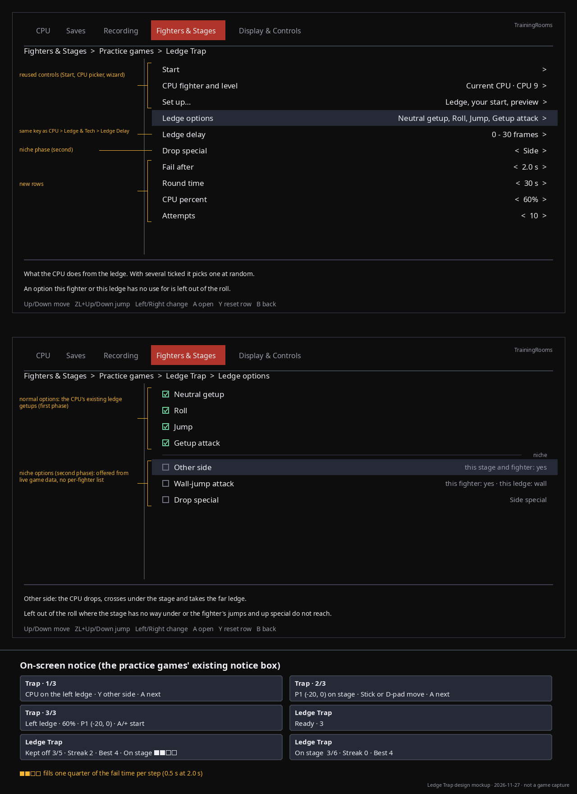
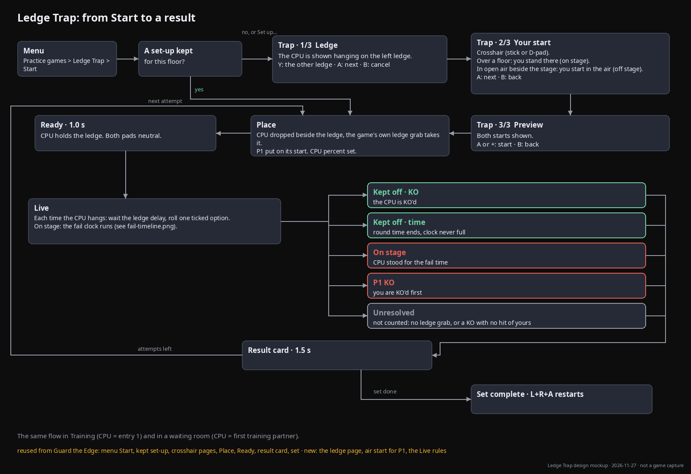
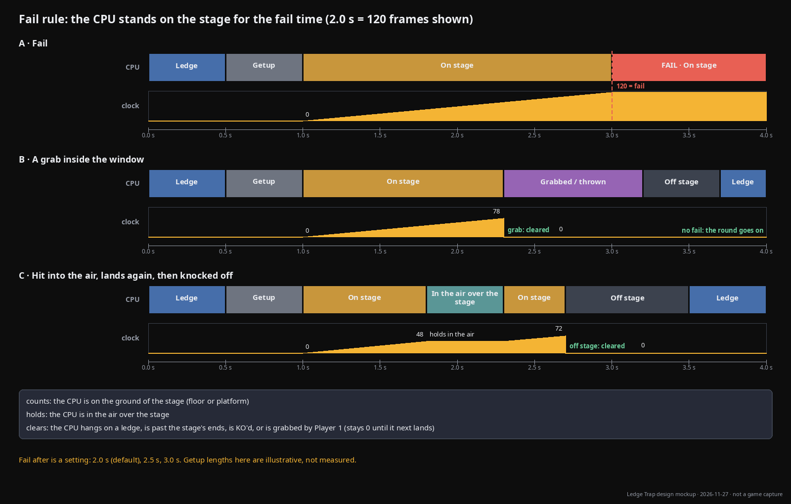

# Ledge Trap: design review

A new practice game: the CPU starts on a ledge, and you keep it off the stage. If it stands on the stage for the fail time, the round fails; a grab inside that window resets the clock. Full design: [DESIGN.md](DESIGN.md). These are drawings, not game captures (2026-11-27).

Phase 1, the game with the four normal ledge options, is being built on the defaults below. Any answer you change is folded in. Phase 2 adds the niche options.

## The menu

## The setup wizard

## The fail rule

## Questions, each with a default

| # | Question | Default |
| --- | --- | --- |
| 1 | Fail time | A setting: **2.0 s** (2.5 s and 3.0 s also offered) |
| 2 | Grab and air time | A grab clears the clock. Air time over the stage holds it (doesn't count as on stage) |
| 3 | Success | A KO, or **30 s** with no fail. No return window. A KO with no hit or grab from you doesn't count |
| 4 | Random | Tick several options and it rolls one each round. Getup attack is included |
| 5 | A K. Rool crown-style mixup | A general **Drop special** option (Side special by default), not a K. Rool-only row |
| 6 | Other side | Only where the stage and the fighter can get under and across (the existing lists) |
| 7 | The CPU on stage | Stock CPU at level 9 |
| 8 | **Size** | Raise the allowance in two measured steps: about **+8 KB** for phase 1, then about **+8 KB** for phase 2. No variant fits in today's room |
| 9 | Ledge delay and CPU percent | Ledge delay shares the CPU page's setting. CPU starts at **60%** |

## Normal and niche options

| Phase | Options |
| --- | --- |
| 1 (normal) | Neutral getup, Roll, Jump, Getup attack |
| 2 (niche, from the game's own data, with no per-fighter lists) | Other side, Wall-jump attack then recover, Drop special |
